<h1 align="center">Anachron</h1>

<p align="center"><b>A smart pocket watch.</b></p>

<p align="center">
  ESP32-S3 &nbsp;·&nbsp; 1.46" round touch display &nbsp;·&nbsp; haptics &nbsp;·&nbsp; rotary crown &nbsp;·&nbsp; USB-C charging &nbsp;·&nbsp; 45 mm 4-layer PCB
</p>

<p align="center">
  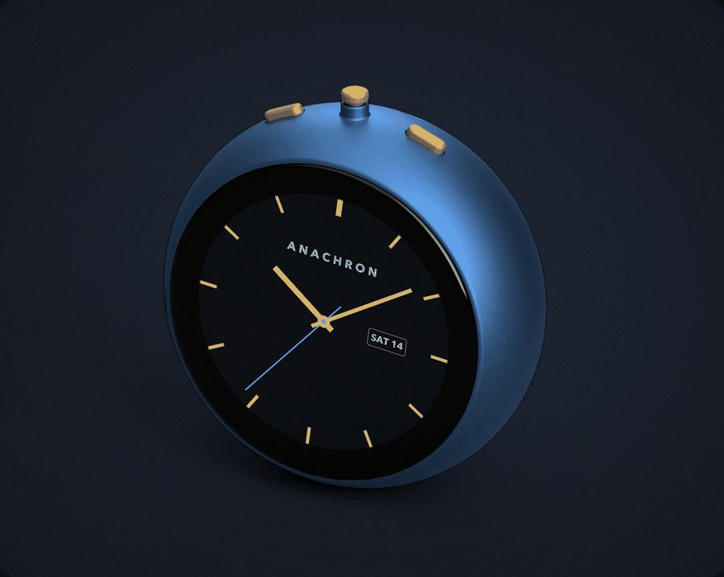
</p>

<p align="center">
  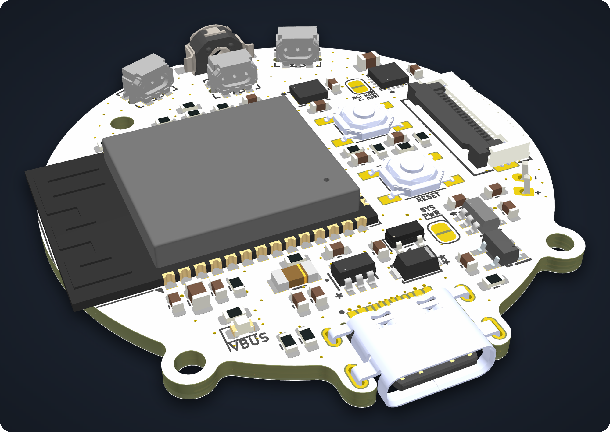
</p>

Anachron is a smart pocket watch: an extension of your phone that does what a smartwatch does, but lives in your pocket instead of on your wrist. The idea comes from the same place as people going back to wired headphones.

Everything sits on one round PCB sized to match the display. An ESP32-S3 drives a 412 × 412 round touch screen, a rotary encoder with a push button behind it acts as the crown, a haptic motor gives feedback, and a LiPo cell charges over USB-C. This repository holds the electronics, designed in KiCad 10, and renders of the enclosure, modeled in Fusion 360.

## Contents

- [Concept](#concept)
- [Hardware](#hardware)
- [Why these parts](#why-these-parts)
- [The board](#the-board)
- [PCB layers](#pcb-layers)
- [Schematics](#schematics)
- [Pin map](#pin-map)
- [Power budget](#power-budget)
- [Firmware notes](#firmware-notes)
- [Bill of materials](#bill-of-materials)
- [Enclosure](#enclosure)
- [Working with the project](#working-with-the-project)

## Concept

<p align="center">
  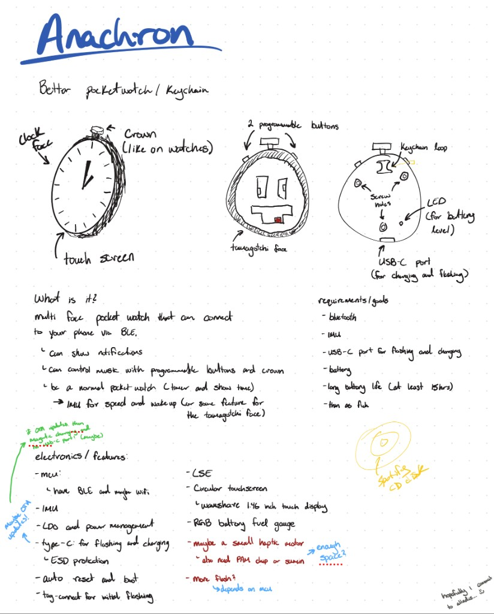
</p>

The original sketch describes a pocket watch or keychain with several faces that connects to a phone over Bluetooth LE. The plan was for it to:

- show notifications from the phone
- control music with the crown and two programmable buttons
- work as a normal pocket watch, with the time and a timer
- switch between faces, including a Tamagotchi-style one and a CD-style one for Spotify
- use the IMU to wake up and to feed features on those faces

The shape in the sketch is the one the board follows: a round touch screen, a crown at the top with a button either side, and a USB-C port at the bottom for charging and flashing. The haptic motor, a "maybe" in the sketch, made it onto the board.

## Hardware

| Block | Part | Details |
| --- | --- | --- |
| MCU | ESP32-S3-WROOM-1-N8R8 | Dual-core 240 MHz, Wi-Fi and Bluetooth LE, 8 MB flash, 8 MB PSRAM, native USB |
| Display | Waveshare 1.46inch Touch LCD Module | Round IPS, 412 × 412, SPD2010 controller. Display over QSPI, touch over I2C (address `0x53`), on an 18-pin 0.5 mm flat-flex cable |
| Motion | Bosch BMI270 | 6-axis IMU on I2C (address `0x69`), both interrupt pins wired, used for wake and gesture detection |
| Haptics | TITAN Drake motor + MAX98357A | The I2S amplifier drives the motor through the `MP1` pads; gain is set by a solder jumper |
| Crown | Alps EC05 rotary encoder + C&K PTS845 | The encoder has no switch of its own, so a push button sits behind it in line with the shaft |
| Side buttons | 2 × C&K PTS845 | Left and right. All three buttons share one ADC pin through a resistor ladder |
| Timekeeping | 32.768 kHz crystal (Seiko SC-32S) | No separate RTC chip: the time is synced from the phone and the crystal keeps it in between |
| Charging | MCP73831 | Single-cell charger at 212 mA with a charge LED |
| Power path | AO3401A + SM5817 | Runs from USB when plugged in, from the battery otherwise |
| Regulator | AP2112K-3.3 | 600 mA, 3.3 V LDO, enabled by the `SYS PWR` solder jumper |
| USB | GCT USB4520 USB-C | USB 2.0 for flashing, with USBLC6-2SC6 ESD protection |
| Battery | 802035 LiPo, 400 to 550 mAh | Has its own protection circuit, plugs into a JST-PH connector, voltage measured through a divider |

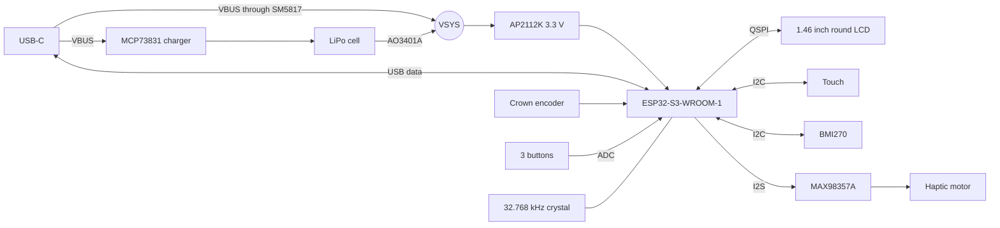

## Why these parts

- **Display:** the 1.46" round panel has the highest resolution and thinnest bezels of the options, and is about the size of a medium pocket watch movement.
- **MCU:** one ESP32-S3 module holds the processor, radio, memory and antenna, which is simpler and cheaper than an STM32 with a separate radio. Its 8 MB of PSRAM holds full frame buffers for the display.
- **IMU:** the BMI270 has gesture detection built in, with nothing to train.
- **Regulator:** an LDO, because the drop to 3.3 V is small and it takes less space than a switching regulator.

## The board

<p align="center">
  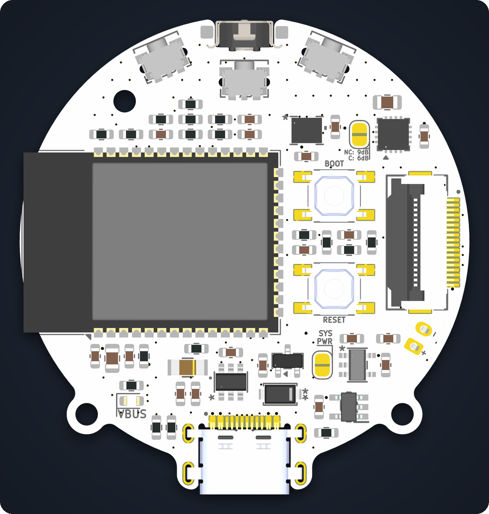
  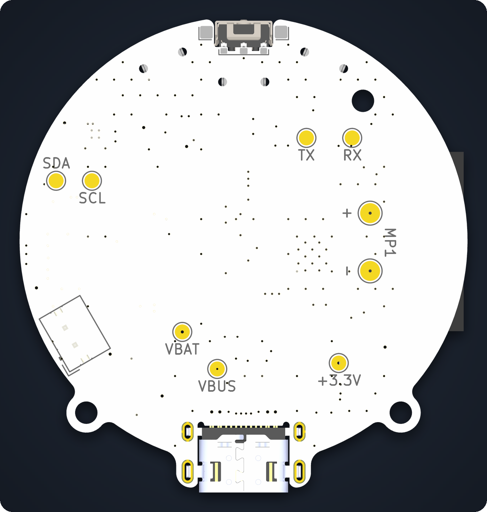
</p>

<p align="center">
  <b>Top</b> (left): nearly every component is on this side. <b>Bottom</b> (right): battery connector, test pads and the haptic motor pads.
</p>

<p align="center">
  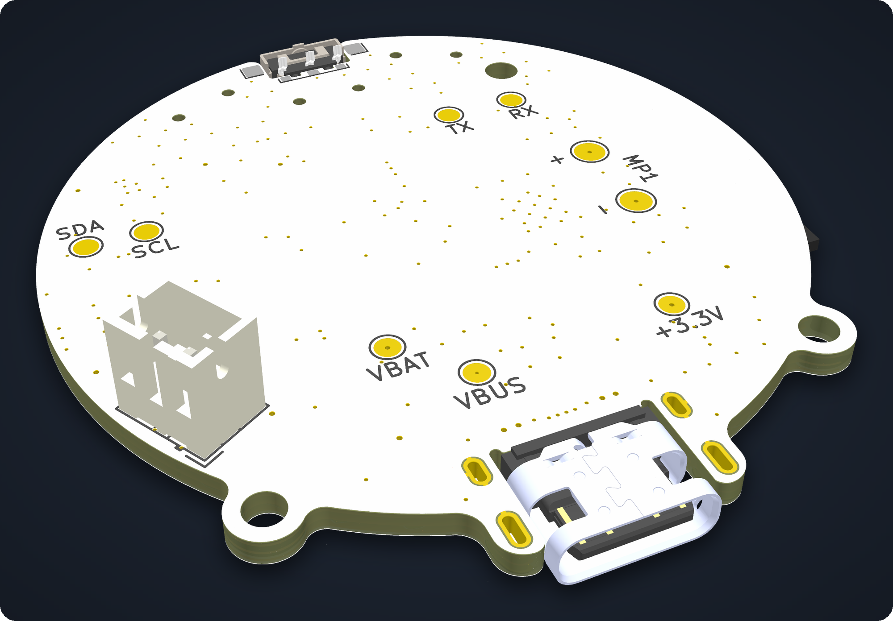
</p>

| | |
| --- | --- |
| Outline | 45 mm circle, 47 mm tall including the USB-C tab and mounting ears |
| Mounting | 3 × 2.25 mm holes |
| Layers | 4 copper layers, 1.6 mm thick |
| Finish | ENIG, white solder mask, black silkscreen |
| Tracks | 0.125 mm to 0.45 mm wide, 0.1 mm minimum clearance |
| Vias | 194 through vias, 0.2 mm and 0.3 mm drills |
| Components | 57 footprints on top, 10 on the bottom |

The crown encoder sits at the top edge with its push button directly behind it and a side button on either side. The USB-C connector is recessed into a cut-out at the bottom, and the display connector is on the right. The ESP32 antenna points off the left edge, and copper is kept out from under it on all four layers.

The board is 45 mm across to match the display module, which is 44.77 mm in diameter.

## PCB layers

<table>
  <tr>
    <td width="50%">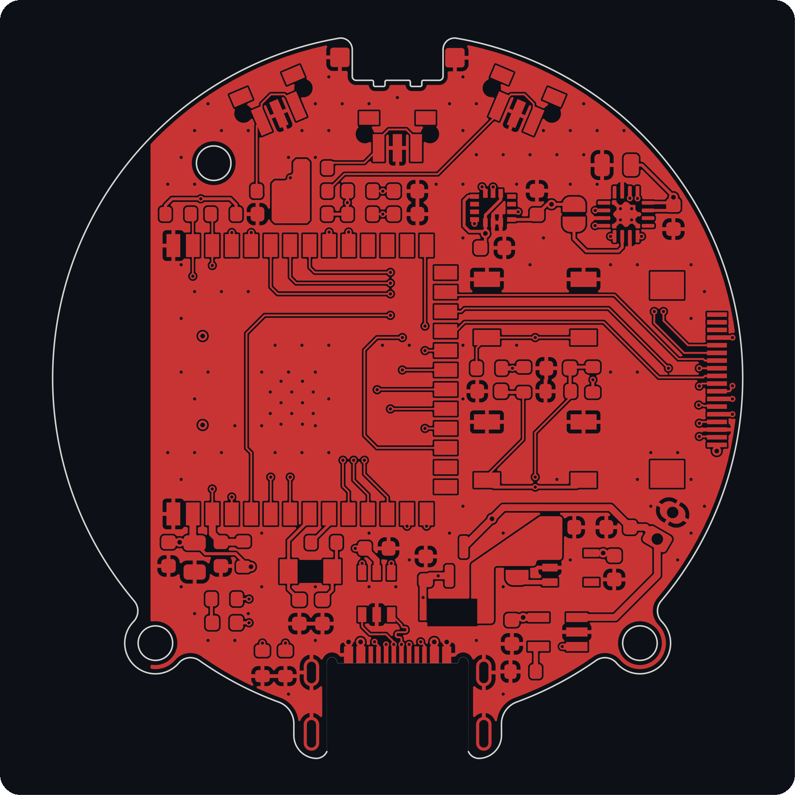</td>
    <td width="50%">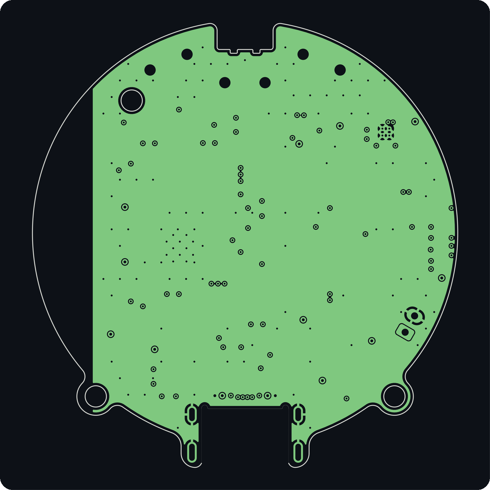</td>
  </tr>
  <tr>
    <td align="center"><b>Layer 1: F.Cu</b><br>Components and most routing, filled with ground.</td>
    <td align="center"><b>Layer 2: In1.Cu</b><br>Unbroken ground plane.</td>
  </tr>
  <tr>
    <td>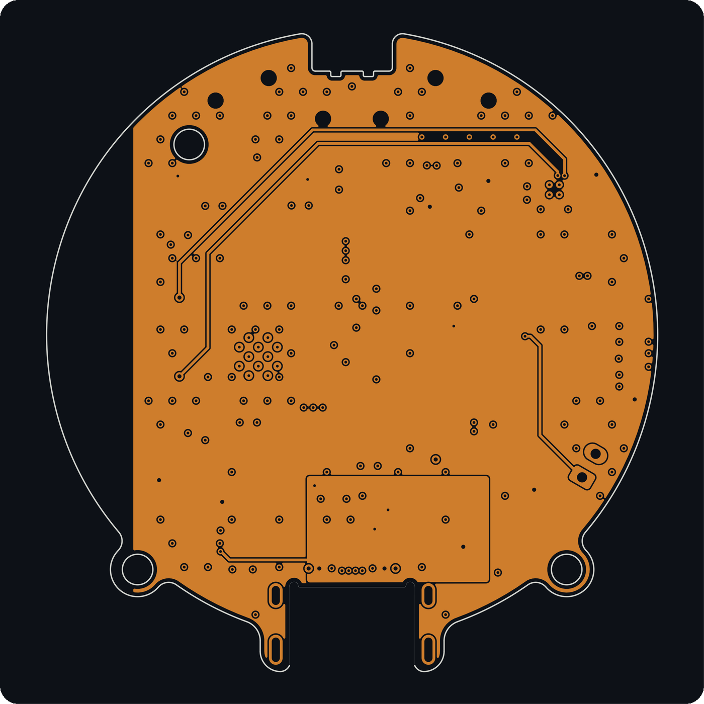</td>
    <td>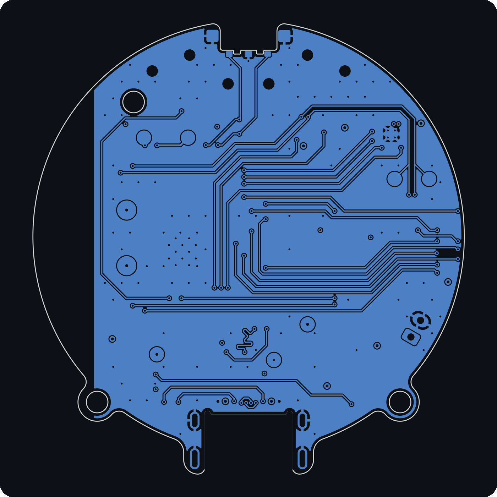</td>
  </tr>
  <tr>
    <td align="center"><b>Layer 3: In2.Cu</b><br>3.3 V plane with a VBUS island by the USB connector.</td>
    <td align="center"><b>Layer 4: B.Cu</b><br>The rest of the routing, filled with ground.</td>
  </tr>
</table>

<table>
  <tr>
    <td width="50%">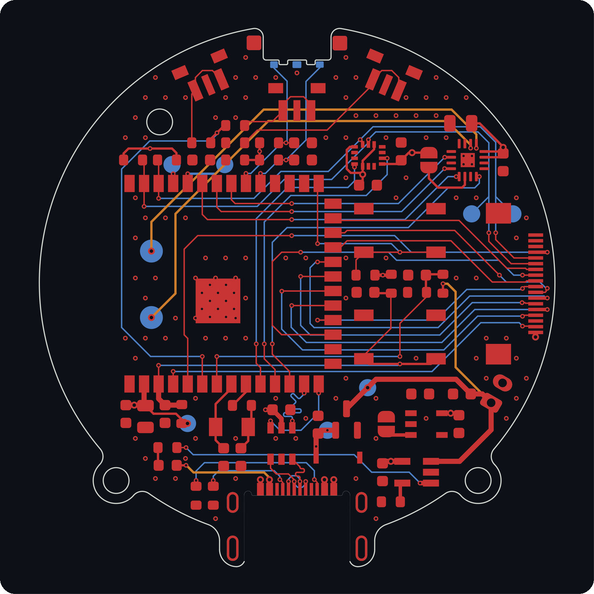</td>
    <td width="50%">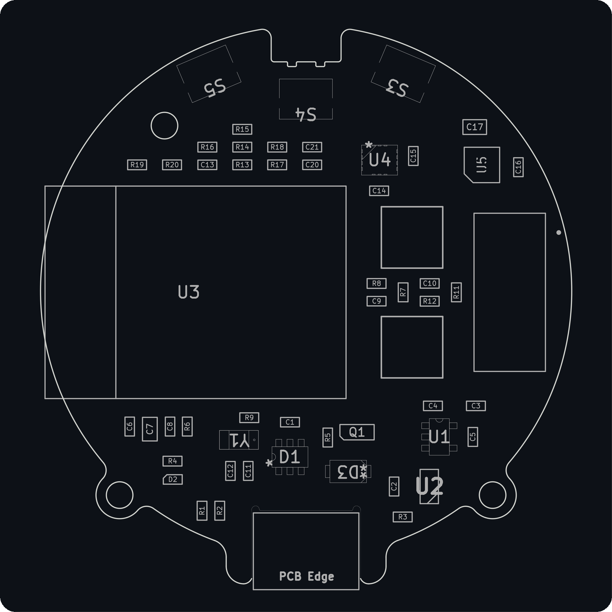</td>
  </tr>
  <tr>
    <td align="center"><b>Routing, all layers</b></td>
    <td align="center"><b>Component placement (F.Fab)</b></td>
  </tr>
</table>

## Schematics

The schematic is split into three sheets. A PDF of all of them is in [`docs/Anachron-schematic.pdf`](docs/Anachron-schematic.pdf).

### MCU and screen

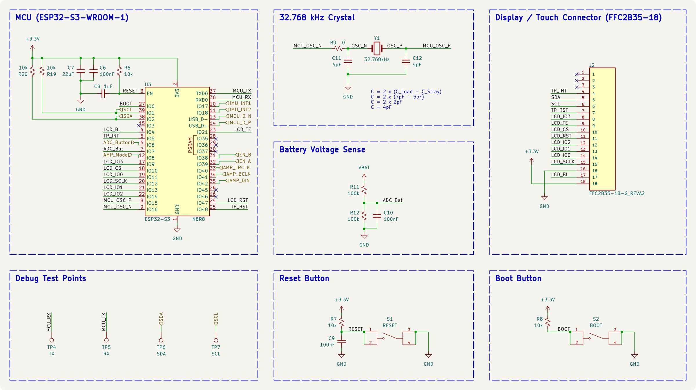

### Peripherals

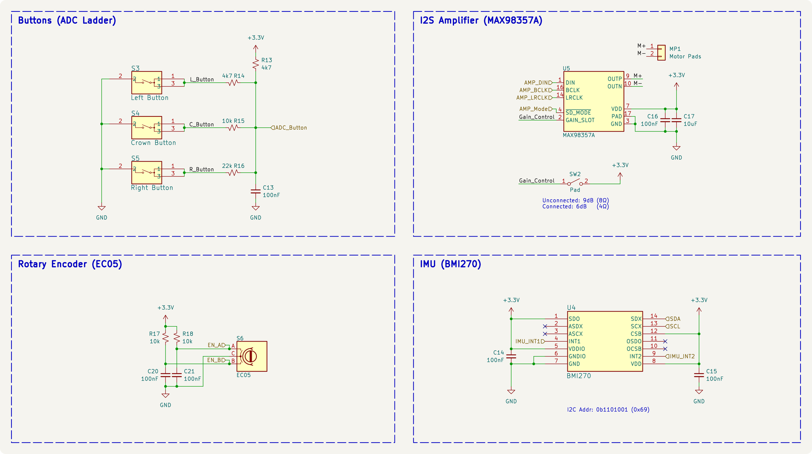

### Power

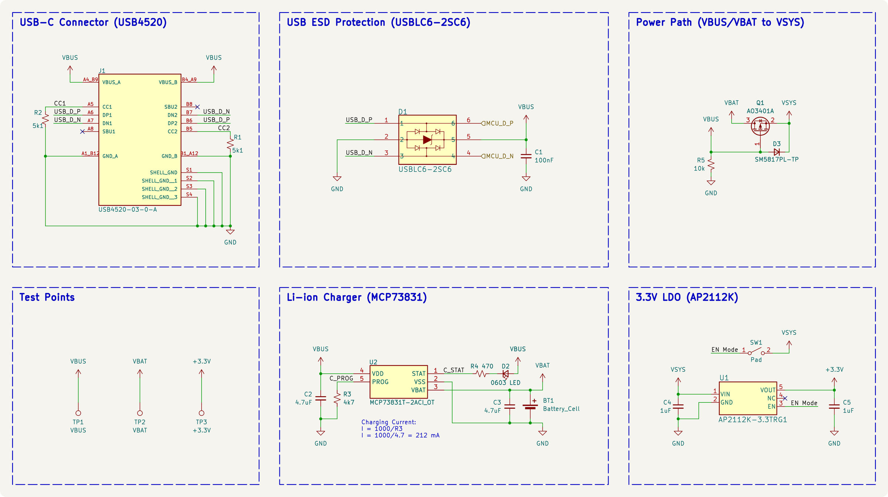

## Pin map

| GPIO | Net | Connects to |
| --- | --- | --- |
| EN | `RESET` | Reset button |
| IO0 | `BOOT` | Boot button |
| IO1 | `SCL` | I2C clock: touch (`0x53`), BMI270 (`0x69`) |
| IO2 | `SDA` | I2C data: touch (`0x53`), BMI270 (`0x69`) |
| IO4 | `LCD_BL` | Display backlight |
| IO5 | `TP_INT` | Touch interrupt |
| IO6 | `ADC_Button` | Button ladder |
| IO7 | `ADC_Bat` | Battery voltage divider |
| IO8 | `AMP_Mode` | MAX98357A shutdown / mode |
| IO9 | `LCD_IO3` | Display QSPI data 3 |
| IO10 | `LCD_CS` | Display chip select |
| IO11 | `LCD_IO0` | Display QSPI data 0 |
| IO12 | `LCD_SCLK` | Display QSPI clock |
| IO13 | `LCD_IO1` | Display QSPI data 1 |
| IO14 | `LCD_IO2` | Display QSPI data 2 |
| IO15, IO16 | `MCU_OSC_P`, `MCU_OSC_N` | 32.768 kHz crystal |
| IO17 | `IMU_INT1` | BMI270 interrupt 1 |
| IO18 | `IMU_INT2` | BMI270 interrupt 2 |
| IO19, IO20 | `MCU_D_N`, `MCU_D_P` | USB D−, D+ |
| IO21 | `LCD_TE` | Display tearing effect |
| IO38 | `EN_B` | Encoder channel B |
| IO39 | `EN_A` | Encoder channel A |
| IO40 | `AMP_LRCLK` | I2S word clock |
| IO41 | `AMP_BCLK` | I2S bit clock |
| IO42 | `AMP_DIN` | I2S data |
| IO43 (TXD0) | `MCU_TX` | Test pad marked `RX` |
| IO44 (RXD0) | `MCU_RX` | Test pad marked `TX` |
| IO47 | `LCD_RST` | Display reset |
| IO48 | `TP_RST` | Touch reset |

IO3, IO45 and IO46 are strapping pins and are left unconnected. IO35 to IO37 are left free because the module's PSRAM uses them. Both analog inputs (IO6 and IO7) are on ADC1, which keeps working while Wi-Fi is on.

## Power budget

The battery was sized for about 10 hours away from the charger, with the screen on for roughly 30 % of that time. These are design estimates, not measurements.

| Load | Current | Time | Charge |
| --- | --- | --- | --- |
| Backlight at full brightness | 40 to 80 mA | 3 h | 120 to 240 mAh |
| Panel and display controller | 10 mA | 3 h | 30 mAh |
| ESP32-S3 active | 30 mA | 3 h | 90 mAh |
| Bluetooth LE, average | 5 mA | 3 h | 15 mAh |
| BMI270, normal mode | 0.7 mA | 3 h | 2 mAh |
| Everything asleep | 0.25 mA | 7 h | 2 mAh |
| **Total** | | | **260 to 380 mAh** |

Taking the middle of that range and allowing for regulator losses and the part of the cell that cannot be used gives a target of about 450 mAh. The cell chosen is an 802035 LiPo, which comes in capacities from 400 to 550 mAh.

## Firmware notes

There is no firmware in this repository yet. These are the things the hardware expects from it:

- **Display.** The panel uses an SPD2010 controller over QSPI and keeps the frame in its own memory. The plan is to use LVGL for graphics. ESP-IDF's `esp_lcd` has QSPI panel drivers, and SPD2010 display and touch components are available for it.
- **IMU.** The BMI270 does nothing until an 8 KB configuration file is uploaded at boot. The likely choice is `bmi270_legacy`: it provides tap, orientation and motion detection, which run on the accelerometer alone so the ESP32 can stay asleep until an interrupt arrives.
- **Time.** The watch gets the time from the phone over Bluetooth and keeps it with the 32.768 kHz crystal while disconnected.
- **Buttons.** The three buttons are read as voltage levels on one ADC pin through a resistor ladder.
- **Flashing.** Over the USB-C port, using the ESP32-S3's built-in USB.

## Bill of materials

<details>
<summary>Show all parts</summary>

| Reference | Qty | Part | Package |
| --- | --- | --- | --- |
| U3 | 1 | ESP32-S3-WROOM-1-N8R8 | Module |
| U1 | 1 | AP2112K-3.3TRG1 | SOT-23-5 |
| U2 | 1 | MCP73831T-2ACI/OT | SOT-23-5 |
| U4 | 1 | BMI270 | LGA-14 |
| U5 | 1 | MAX98357A | TQFN-16 |
| D1 | 1 | USBLC6-2SC6 | SOT-23-6 |
| D2 | 1 | LED | 0603 |
| D3 | 1 | SM5817PL-TP | SOD-123FL |
| Q1 | 1 | AO3401A | SOT-23 |
| Y1 | 1 | Seiko SC32S-7PF20PPM, 32.768 kHz crystal | SC-32S |
| J1 | 1 | GCT USB4520-03-0-A | USB-C receptacle |
| J2 | 1 | GCT FFC2B35-18-G | 18-pin 0.5 mm FFC |
| BT1 | 1 | JST B2B-PH-K | JST-PH 2-pin |
| S1, S2 | 2 | TS18-5-25-SL-160-SMT-TR (reset, boot) | Tactile switch |
| S3, S4, S5 | 3 | C&K PTS845 (left, crown, right) | Side-actuated tactile switch |
| S6 | 1 | Alps EC05E1220401 | Rotary encoder |
| C1, C6, C9, C10, C13, C14, C15, C16, C20, C21 | 10 | 100 nF | 0603 |
| C4, C5, C8 | 3 | 1 µF | 0603 |
| C2, C3 | 2 | 4.7 µF | 0603 |
| C11, C12 | 2 | 4 pF | 0603 |
| C17 | 1 | 10 µF | 0805 |
| C7 | 1 | 22 µF | 0805 |
| R9 | 1 | 0 Ω | 0603 |
| R4 | 1 | 470 Ω | 0603 |
| R3, R13, R14 | 3 | 4.7 kΩ | 0603 |
| R1, R2 | 2 | 5.1 kΩ | 0603 |
| R5, R6, R7, R8, R15, R17, R18, R19, R20 | 9 | 10 kΩ | 0603 |
| R16 | 1 | 22 kΩ | 0603 |
| R11, R12 | 2 | 100 kΩ | 0603 |
| SW1, SW2 | 2 | Solder jumper | |
| TP1 to TP7 | 7 | Test pad, 1.5 mm | |
| MP1 | 1 | Haptic motor pads | |

</details>

Parts that connect to the board:

| Part | Connects to |
| --- | --- |
| Waveshare 1.46inch Touch LCD Module (412 × 412, SPD2010) | `J2`, 18-pin 0.5 mm flat-flex cable |
| 802035 LiPo cell with protection circuit, 400 to 550 mAh | `BT1`, JST-PH |
| TITAN Drake haptic motor | `MP1` pads |

## Enclosure

The enclosure was modeled in Fusion 360 with a satin blue anodized aluminum appearance and matte brass controls. The faces in the render at the top of this page are mockups; there is no firmware yet.

<p align="center">
  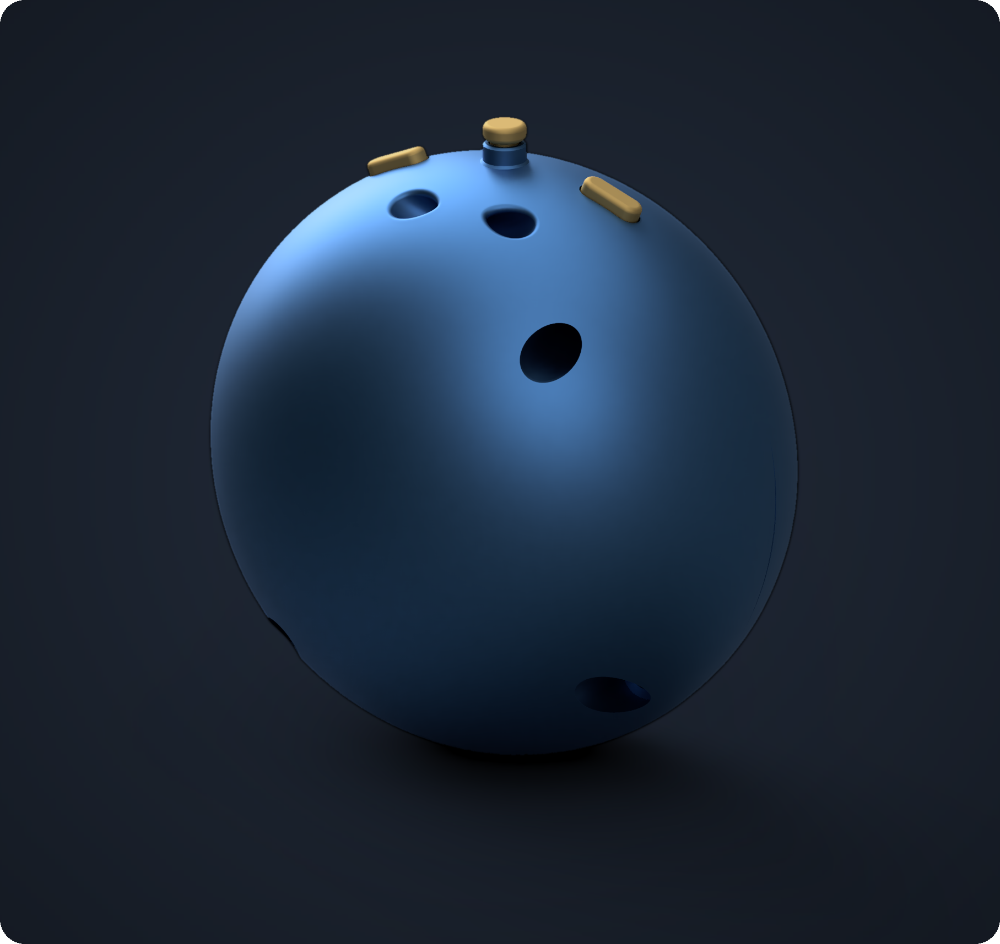
</p>

<p align="center">
  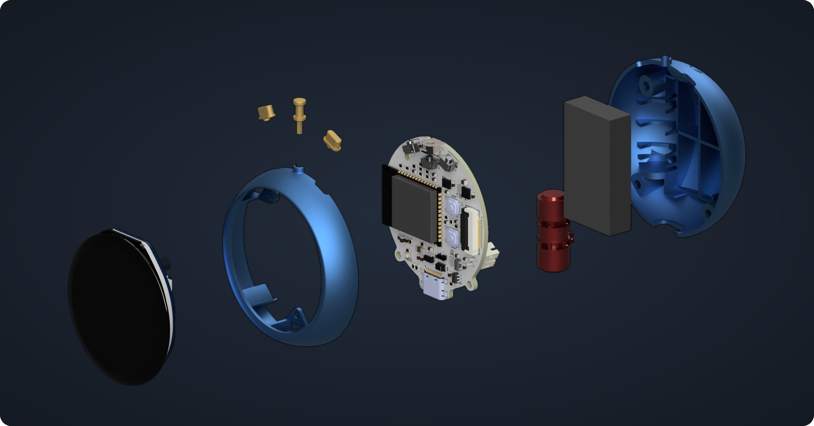
</p>

The exploded view shows the display, front housing, populated PCB, battery and rear housing in assembly order. The crown, buttons, and haptic motor are spaced out to show where they fit.

<table>
  <tr>
    <td width="50%">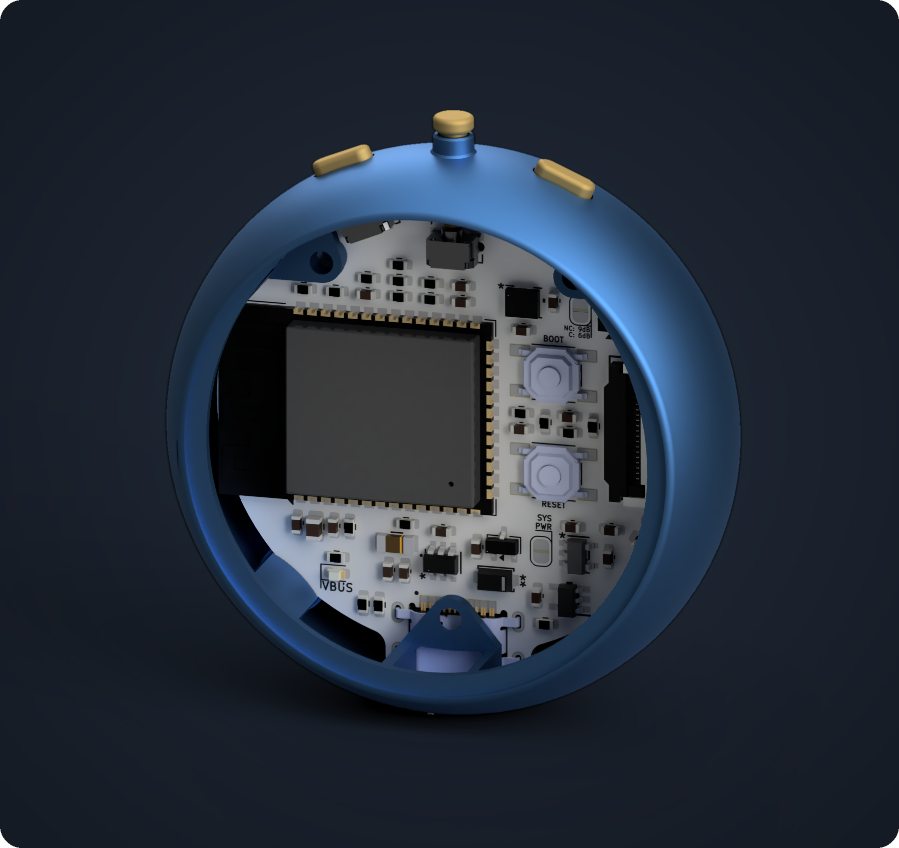</td>
    <td width="50%">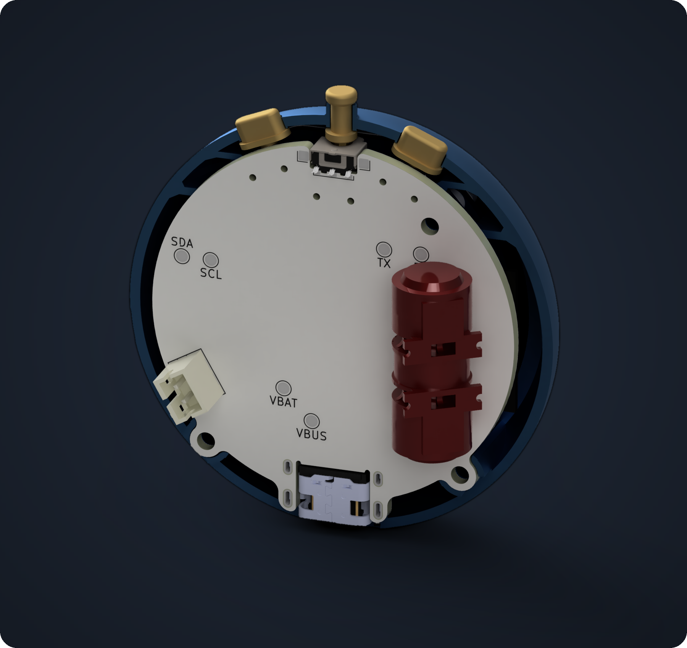</td>
  </tr>
  <tr>
    <td align="center"><b>Front interior</b><br>With the display removed from view.</td>
    <td align="center"><b>Rear interior</b><br>With the back shell and battery hidden.</td>
  </tr>
</table>

The display module sets the proportions: it is 44.77 mm across and already 9.6 mm thick, where a traditional pocket watch is 9 to 15 mm in total. The case is built tightly around the display, board and battery to keep the watch as slim as that stack allows.

## Working with the project

Open `kicad/Anachron.kicad_pro` in KiCad 10. The custom symbols, footprints and 3D models are in `kicad/Library` and are referenced relative to the project, so nothing else needs installing. The [enclosure STEP files](3d%20models/) include both shell halves, the crown, and both side buttons.

```
kicad/
  Anachron.kicad_pro      project
  Anachron.kicad_sch      top-level sheet
  MCUScreen.kicad_sch     MCU, display connector, crystal, battery sense
  Peripherals.kicad_sch   buttons, encoder, amplifier, IMU
  power.kicad_sch         USB-C, charger, power path, regulator
  Anachron.kicad_pcb      board
  Library/                symbols, footprints and 3D models
3d models/                individual enclosure STEP files
docs/
  images/                 renders, layer plots and schematic images
  fusion/                 Fusion 360 renders as exported
  faces/                  pictures used on the mockup watch faces
  sketches/               hand-drawn concept sketch
  Anachron-schematic.pdf  all schematic sheets
  scripts/render_docs.py  regenerates the README images and schematic PDF
```

The PCB renders, layer plots and schematic images are generated from the KiCad files. The enclosure images are made from the Fusion 360 renders in `docs/fusion/`: the script puts them on the same dark background and builds the mockup faces shown at the top of this page, using the pictures in `docs/faces/`. To refresh everything, run the following command.

```sh
python3 docs/scripts/render_docs.py
```

To refresh only some of the images, name the groups: `3d`, `layers`, `sch` or `fusion`. For example, `python3 docs/scripts/render_docs.py fusion` redoes just the enclosure images after a new export from Fusion 360.

The script needs KiCad's `kicad-cli`, [Pillow](https://pypi.org/project/pillow/), [NumPy](https://numpy.org/), [SciPy](https://scipy.org/) and macOS.
